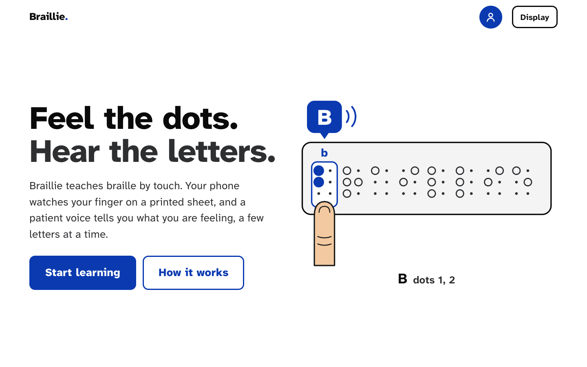
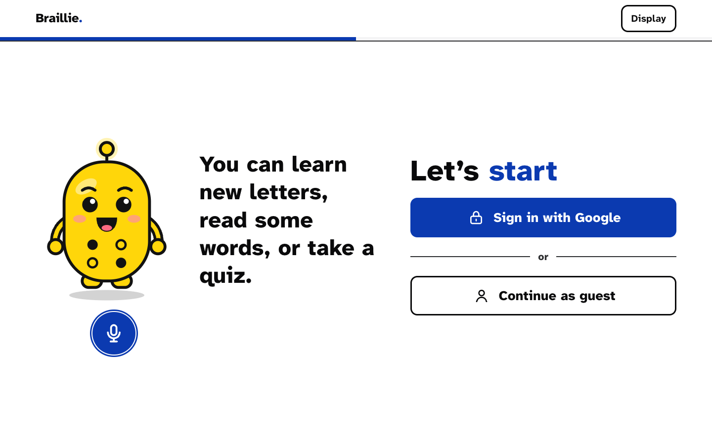
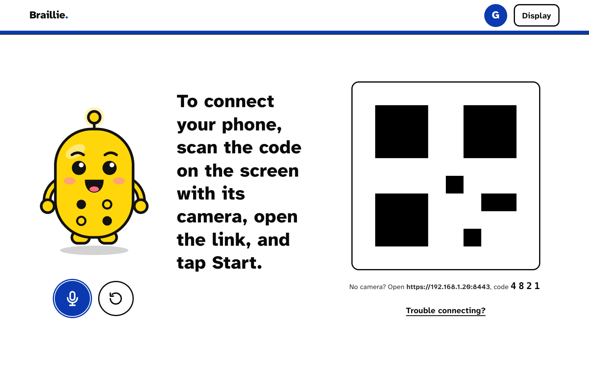
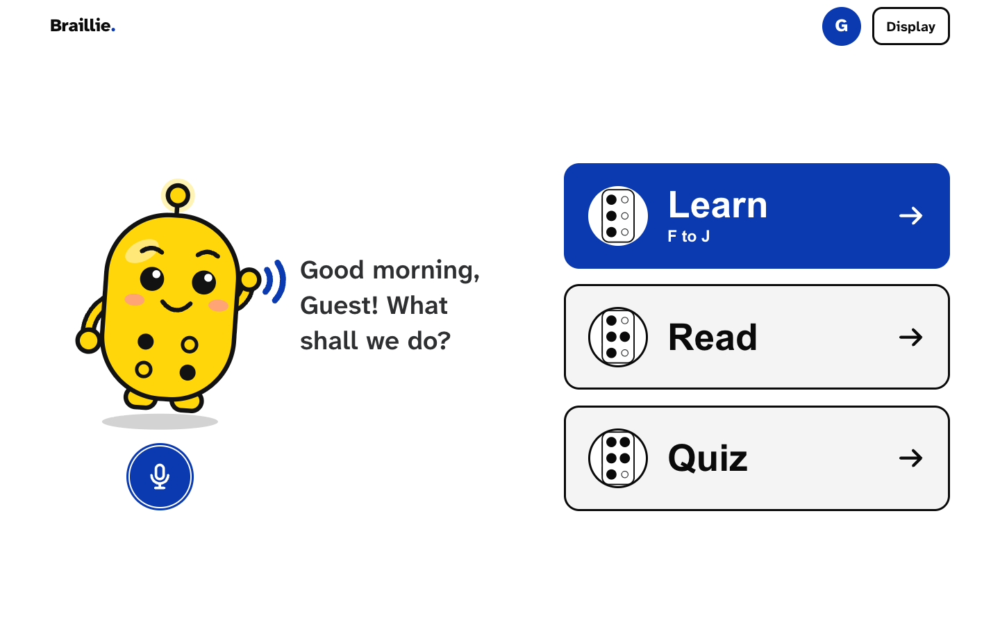
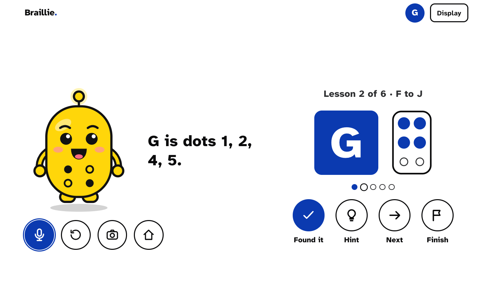
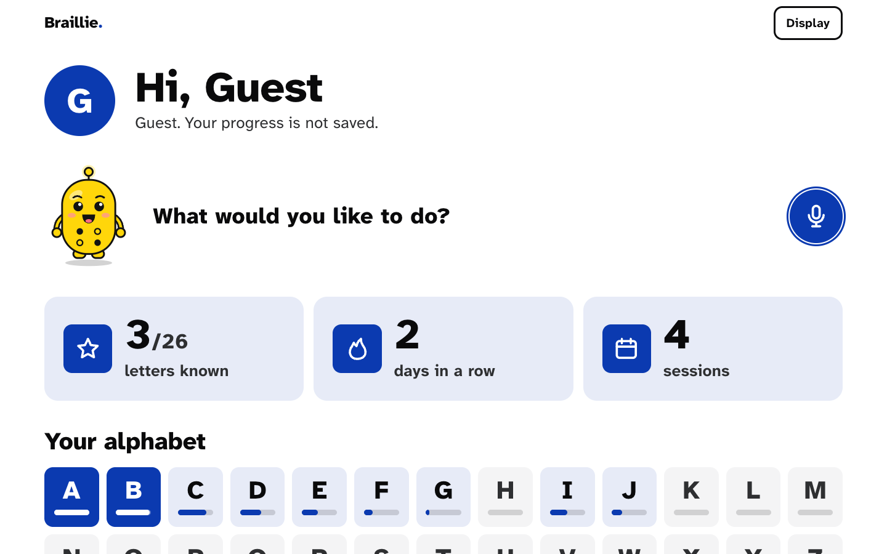
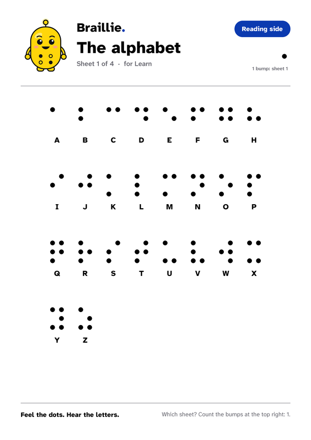
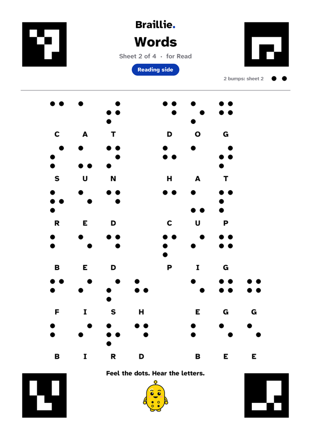
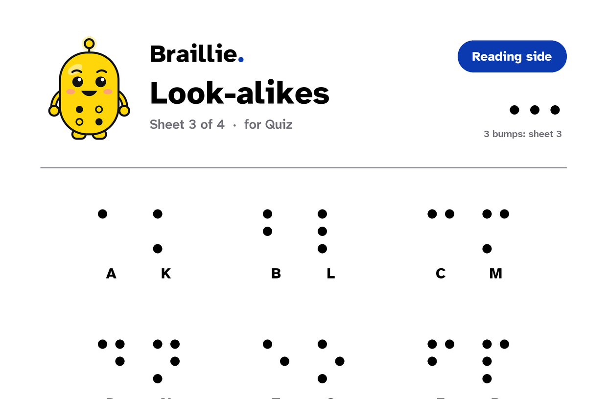
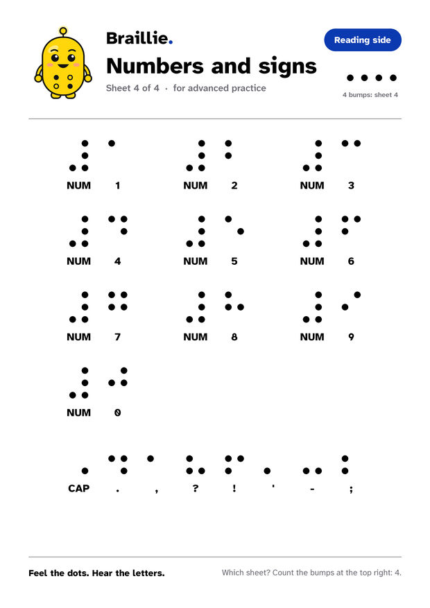

# Braillie

**Learn braille by touch, with Braillo: a tutor who talks you through it and hears you back.**

Braillie watches a printed braille sheet through your phone's camera, follows your finger, and works out which letter you're
touching. Then Braillo, its friendly braille-cell tutor, teaches you, reads to you, or quizzes you out loud. It's built for people
who can't see the screen: from the front page to your progress, **everything can be done by voice.**

<p align="center"><br><b>The front page</b>: Braillo offers to talk you through it.</p>

## What it does

- **Lessons that feel like lessons.** Eight short lessons take you from A to Z, then letters that look alike, numbers, and
  capitals and punctuation. Each letter is described by its dots and how it grows from one you know; you find it and rest your
  finger on it, or point and say "this one". Then a mixed practice and, if it went well, you **spell a real word** by touch.
  Mistakes are explained ("That's F. D has a dot at the middle-right…"), and letters that went wrong come back next lesson.
- **Starts where you are.** Before your first lesson, Braillo asks how much braille you know (new, some letters, the alphabet,
  or numbers too) and starts you there, checking the earlier letters as you go.
- **Reads a real printed braille sheet.** A YOLOv8 detector finds every raised dot and registers the page, so it knows which
  cell your finger is on. **MediaPipe's hand model** finds your index fingertip, across skin tones and lighting.
- **Read and Quiz.** **Read** speaks a word aloud when you rest a finger on it. **Quiz** names a look-alike letter, and you point
  at it and say "this one", or its name.
- **Everything works by voice.** Say a button's name to press it, or "go back", "home", "my page". "Help" says what you can do
  on the page you're on.
- **Braillo knows what's going on.** Say "Braillo" and ask anything, or just talk: with an Anthropic API key, Claude works out what
  you meant, knowing the page you're on, what the camera sees, which letter your finger is on, your progress, and what he's
  waiting for you to do. ("I can't find it" gets a hint; "can we move on?" goes to the next lesson.)
- **A phone is the camera.** Scan a QR code and your phone becomes Braillie's eyes. Braillo talks and listens through the
  laptop, whose echo canceller keeps him from hearing himself (`--sound phone --mic phone` moves both to the phone instead). If the
  Wi-Fi blocks the phone, say "it's not working" and the code switches to a backup link over a tunnel.
- **Speech that starts straight away.** Braillo's voice (Deepgram Aura 2) plays as it's made, with captions that follow along
  sentence by sentence.
- **Built for blind and low-vision users.** Screen-reader-friendly markup, every action on a key as well as by voice, WCAG AAA
  colour contrast, light, dark and two high-contrast themes, and four text sizes.
- **Remembers your progress.** Google sign-in keeps it across sessions. Guests go straight in, and nothing of theirs is saved.

## A look around

<p align="center"><br><b>Sign in</b>: say "Google" or "guest".</p>

<p align="center"><br><b>Connect your phone</b>: scan the code; Braillo talks you through it.</p>

<p align="center"><br><b>Home</b>: say learn, read or quiz.</p>

<p align="center"><br><b>A lesson</b>: find the letter by touch, with hints when you need them.</p>

<p align="center"><br><b>Your page</b>: Braillo reads out how you're doing.</p>

## Try it in a few minutes

You'll need Python 3.10+, Node 20+, a webcam or a phone, and a free [Deepgram](https://deepgram.com) API key (it does the
speaking and listening). An [Anthropic](https://console.anthropic.com) API key is optional: it lets Braillo answer questions and
understand free speech; everything else works without it.

```bash
git clone https://github.com/MrFiscus/Braillie.git
cd Braillie

# Python side: detection, finger tracking, the tutor, the phone link
python3 -m venv braille_tutor/.venv && source braille_tutor/.venv/bin/activate
pip install -r braille_tutor/requirements.txt -r requirements-voice.txt
git clone https://github.com/snoop2head/DotNeuralNet braille_tutor/third_party/DotNeuralNet

# Website
cd website-frontend && npm install && cd ..

# Your keys (never commit this file)
cp .env.example .env   # then fill in DEEPGRAM_API_KEY (and ANTHROPIC_API_KEY for Braillo's questions)
```

Then, from the repo root, with the venv active:

```bash
./run_all.sh
```

This starts the tutor and the website together and opens **http://localhost:5173**. Braillo greets you there. Sign in (or go in as
a guest), scan the QR code with your phone, and choose Learn, Read or Quiz. MediaPipe's hand model (about 8 MB) is downloaded by
itself the first time; without it, Braillie falls back to finding the finger by skin colour.

On a network that blocks phone-to-laptop traffic (most public Wi-Fi), Braillie switches to a **backup link** by itself: if
[`cloudflared`](https://github.com/cloudflare/cloudflared) is installed, a tunnel is made ready at start, and when no phone has reached
the laptop 40 seconds after the code is shown, the QR code changes to it (or press the globe key on the Connect Phone page). For a demo on
poor Wi-Fi, the most reliable setup is still the phone's hotspot for both devices. `./run_all.sh --phone-tunnel` uses the tunnel from
the start; see [`braille_tutor/README.md`](braille_tutor/README.md#phone-as-the-camera-scan-a-qr-code---phone-camera) for every
connection mode and what each trades off.

Only one browser tab talks to Braillo at a time: the one you're using.

## What you can say

| Anywhere | In a lesson or the quiz | Getting around |
|---|---|---|
| **help** (a sentence) · **more options** (everything) | **this one** / **found it** (or the letter's name) | any button's name, e.g. **start learning** |
| **repeat** · **quiet** · **slower** · **faster** | **hint** · **next** (skip) · **repeat** | **go back** · **scroll down** · **scroll up** |
| **Braillo**, then any question | **next lesson** · **previous lesson** · **lesson three** | **home** · **my page** · **sign out** |
| **learn** · **read** · **quiz** | **explore** · **practice** · **stop** | |

## Print a sheet and try it today

The four practice sheets are already generated and checked in as one print-ready PDF:
**[`braillie-sheets.pdf`](braille_tutor/sheet/braillie-sheets.pdf)** (A4, a page per sheet, printed on **both sides** at **100% / no scaling**).
The website's *Print your sheets* button downloads the same file.

<p align="center"><a href="braille_tutor/sheet/1_alphabet_reading.png"></a><br><b>Alphabet A–Z</b>: used by <b>Learn</b> · • 1 bump</p>

<p align="center"><a href="braille_tutor/sheet/2_words_reading.png"></a><br><b>Words</b>: used by <b>Read</b> · •• 2 bumps</p>

<p align="center"><a href="braille_tutor/sheet/3_lookalikes_reading.png"></a><br><b>Look-alikes</b>: used by <b>Quiz</b> · ••• 3 bumps</p>

<p align="center"><a href="braille_tutor/sheet/4_numbers_reading.png"></a><br><b>Numbers &amp; signs</b>: lessons 7 and 8 · •••• 4 bumps</p>

Each sheet has two sides that line up dot for dot:

- **Reading side:** black dots with their letters. This is the side you feel and the side the camera reads.
- **Poking side:** a mirror image, with a circle around every dot to push through.

**To make a physical page:**

1. Print the PDF double-sided, flipping on the long edge.
2. Lay a page **poking side up** on a corkboard, foam sheet or thick cardboard.
3. Push through the centre of every circle with anything blunt: a used ballpoint pen, a knitting needle, or an unfolded paperclip.
4. Turn the page over. The bumps on the reading side are your braille.

If you can't do this yourself, ask someone to print and poke the sheets for you. Hold the whole page flat under the camera, on a
plain surface that contrasts with the paper.

**Telling sheets apart by touch:** a row of bumps at the top right of each sheet gives its number. The alphabet has 1 bump, words
has 2, look-alikes has 3, and numbers has 4. Braillo describes each sheet the same way when it asks for one ("the one with two bumps
in its top right corner").

**The four black squares in the corners** of the reading side are markers for the camera. From any three of them it places the
page in every frame, so the phone can move, a hand can cover an edge, or part of the paper can be out of view, and your finger is
still read on the right cell. If the markers can't be seen, Braillie falls back to the paper's own four edges. To rebuild the
sheets, run `python braille_tutor/make_sheet.py`. The older single-sided templates (with or without registration markers) can still
be made by name, e.g. `python make_sheet.py alphabet`; see
[`braille_tutor/README.md`](braille_tutor/README.md#reading-our-printed--poked-sheets-correctly---sheet). For reading a real
embossed braille book page, there is `--mode explore`.

## How it works

The phone (or a webcam) streams frames to the laptop. A YOLOv8 detector finds every braille cell and its raised dots, a
page-registration step maps pixels to real page millimetres, and MediaPipe's hand landmarks give the index fingertip, tracked and
smoothed in page millimetres. The Python tutor (`braille_tutor/tutor.py`, lessons in `learn.py`) decides what to say and drives Learn,
Read and Quiz. Deepgram (`voice_io.py`, at the root) turns its words into speech, streamed as it's made, and your voice into commands;
anything that isn't a command goes to Claude (`llm.py`), which is told what's happening and what's expected next.

The React website polls the tutor's local HTTP API for its state, and tells it which page is open and the names of the controls on
it, so any of them can be used by voice. Braillo, drawn in SVG, breathes, blinks, looks around, leans in to listen, and hops for joy at
a right answer; everything holds still for anyone who has asked their device for less motion.

## Repo layout

```
braille_tutor/        Detection (YOLOv8 + page registration), finger tracking (MediaPipe), the tutor and its lessons,
                       the phone link (QR pairing, certificates, tunnel, streamed speech), the local HTTP API,
                       Braillo's Claude helper (llm.py), and sheet/: the printable practice sheets above.
                       See braille_tutor/README.md (full detail) and API.md (the HTTP API).
website-frontend/     React + TypeScript + Vite: the landing page, voice-driven sign-in, phone pairing, home, the
                       activities and your page; src/voice/ holds the voice control for the whole site.
voice_io.py            Deepgram speech in and out (streamed), used by the tutor.
run_all.sh              Starts the tutor and the website together (the way to run it above).
requirements-voice.txt  Root-level Python deps for voice_io.py.
backend/               Word checking for Read (braillie/word_correction.py: a misread word is read again, never guessed).
```

## Documentation

- [`braille_tutor/README.md`](braille_tutor/README.md): the full technical write-up: every CLI flag and mode, how page
  registration and locking work, reading a real embossed book page, the accessibility features, the phone link's connection
  modes, the AI coach, and known limits.
- [`braille_tutor/API.md`](braille_tutor/API.md): the tutor's local HTTP API, for anyone building another frontend against it.

## Testing

```bash
cd braille_tutor && python -m unittest discover -p "test_*.py"   # 640+ tests: detection, finger tracking, lessons, tutor, phone link, voice
cd website-frontend && node --test "tests/*.test.mjs"            # sign-in voice, profile voice, colour contrast, progress sync
```

(The `test_*.py` files at the repo root are hand-run voice scripts: `test_speak.py` speaks through Deepgram and
`test_mic_pin.py` opens the live microphone, so run them on purpose, not with pytest.)

## Team

Built at HACKMIT by **Smaran Pokharel** (braille detection, the tutor, phone pairing, the accessible website), **Tenzing
Gurung** (voice I/O, word-checking, demo-night reliability fixes), **Reagan Spurlock** (the first version of the website), and
**Sage Peterson** (the physical braille sheets, video and technical support).

## Credits

Detection uses the pretrained YOLOv8 weights from [DotNeuralNet](https://github.com/snoop2head/DotNeuralNet) by snoop2head (MIT
License), cloned separately, not modified. Finger tracking uses Google's [MediaPipe](https://github.com/google-ai-edge/mediapipe)
hand landmarker (Apache License 2.0). See [`braille_tutor/README.md`](braille_tutor/README.md#credits) for the full attribution.
